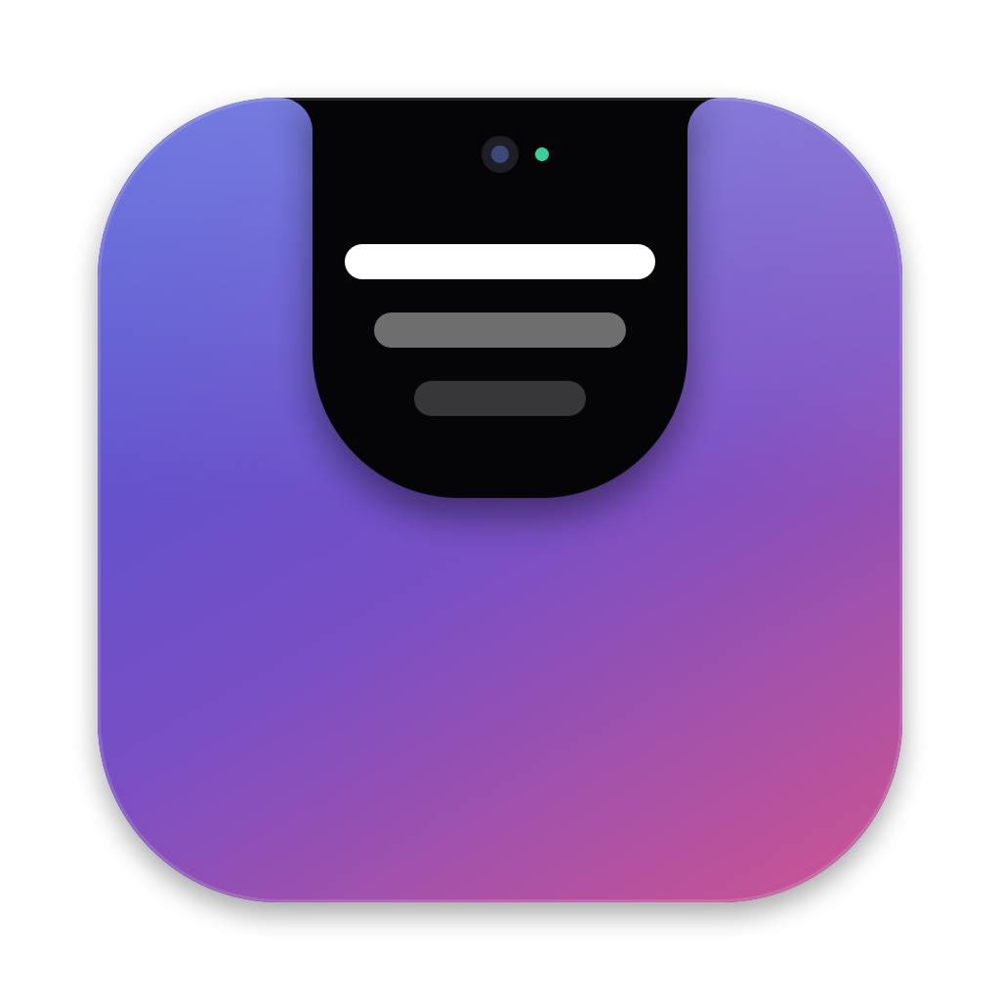
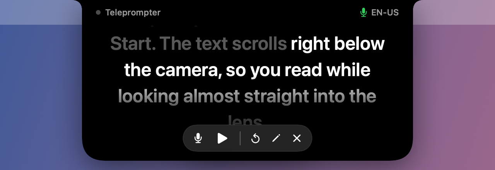
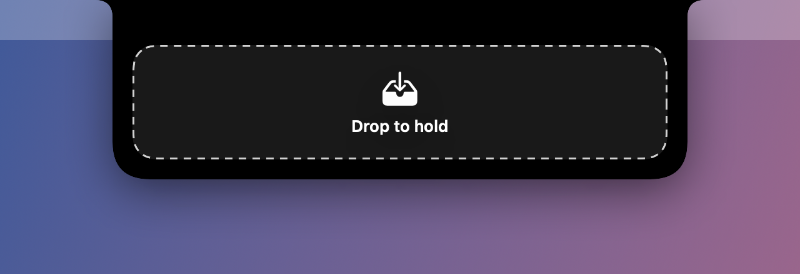
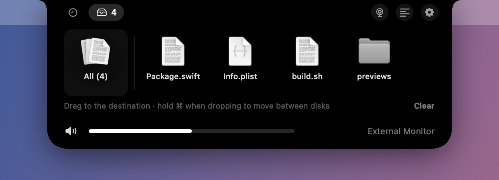
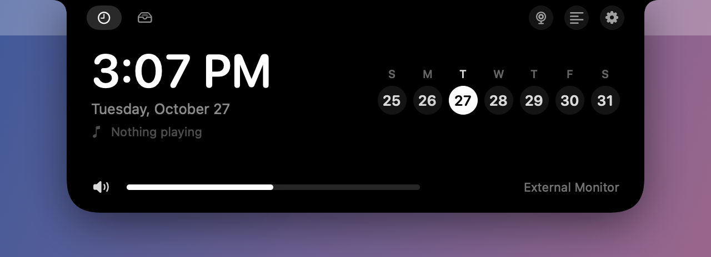

<p align="center">
  
</p>

# Marquise

**A Dynamic Island for the Mac notch — with a camera-aligned teleprompter, a mirror and a file shelf.**

[Português (Brasil)](README.pt-BR.md) · [Download](../../releases/latest) · [Changelog](CHANGELOG.md) · [Security](SECURITY.md)

<p align="center">
  
</p>

Marquise lives in the MacBook notch. Closed, it blends into the notch and shows small live
indicators. Hover over it and it opens with a clock, the song that is playing and your
file shelf. It also turns into a teleprompter that sits right below the camera, so you can
read a script while looking almost straight into the lens, or into a mirror to check how
you look before a meeting — and it can hide itself from screen recordings and screen sharing.

- Native Swift and SwiftUI, no dependencies, under 1 MB
- Runs fully on your Mac: no accounts, no analytics, no tracking
- English (US and UK), Portuguese (Brazil and Portugal) and Spanish

## Features

### Teleprompter

<p align="center">
  
</p>

- **Aligned with the webcam.** The text scrolls in a narrow column right below the
  camera, so your eyes stay close to the lens and the reading doesn't show.
- **Follows your voice** (macOS 26 or later). Marquise listens and moves the text as you
  speak, word by word. It handles skipped words, repeats and going back to reread a
  passage. Spoken words are dimmed so you never lose your place.
  - Speech recognition runs on the Mac. Audio never leaves your computer.
  - Works in English (US, UK), Portuguese (Brazil, Portugal) and Spanish. The language is
    detected from the script, or you can choose it.
  - The first time, macOS downloads the speech model for that language.
- **Fixed speed mode** for when you'd rather not use the microphone.
- **Hidden from screen capture** (on by default): Marquise, the teleprompter included, and
  the script editor are left out of screen recordings and screen sharing. You can turn this
  off in the script editor. See [Limitations](#known-limitations).
- **Adjustable:** speed, column width, text size and a mirrored mode for teleprompter glass.
- **Script editor** with copy and paste, plus a *Paste script* button.

| Shortcut | Action |
| --- | --- |
| <kbd>⌃</kbd><kbd>⌥</kbd><kbd>T</kbd> | Open or close the teleprompter |
| <kbd>⌃</kbd><kbd>⌥</kbd><kbd>Space</kbd> | Pause or resume |
| <kbd>⌃</kbd><kbd>⌥</kbd><kbd>↑</kbd> / <kbd>↓</kbd> | Faster or slower |
| Trackpad scroll | Move forward or back in the script |
| <kbd>⌃</kbd><kbd>⌥</kbd><kbd>M</kbd> | Open or close the [mirror](#mirror) |

Hover over the teleprompter for its controls: voice on or off, play, restart, edit and close.

### Mirror

Check your hair, light and framing before joining a call, even at the last second:
press <kbd>⌃</kbd><kbd>⌥</kbd><kbd>M</kbd> or click the camera button in the open island.

- Shows the Mac camera, mirrored, right below the notch, the same view people will get.
- Uses the built-in camera, even when an iPhone or external camera is connected.
- The camera turns on only while the mirror is open. Nothing is recorded or saved.
- Close it with the ✕ button, the same shortcut or a click anywhere else.
- If the teleprompter is open, it pauses underneath and comes back when the mirror closes.
- Hidden from screen recordings and screen sharing along with the rest of Marquise.

### File shelf

<p align="center">
  
  
</p>

Moving files between folders or disks without copy and paste:

1. Drag files to the notch. It turns into a drop zone and holds them.
2. Open the folder or disk where they should go.
3. Drag them out of the shelf, one at a time or all at once.

Marquise only keeps a reference to each file; nothing is copied when you drop it on the
shelf. When you drag it out, the Finder decides as usual: on the same disk the file is
moved, to another disk it is copied. Hold <kbd>⌘</kbd> while dropping to move between disks.
Items leave the shelf once they have been dropped somewhere.

### Now playing, volume and clock

<p align="center">
  
  
</p>

- Album art and a live visualizer while **Music** or **Spotify** is playing; open the
  island for the title, artist, progress and playback controls.
- When nothing is playing: time, date and the current week.

### Volume, including external monitors

- A volume bar with mute in the open island, showing which output is playing.
- Scroll over the notch with two fingers (or the mouse wheel) to change the volume, and
  see the level right there.
- **Monitors and TVs work too.** macOS can't change the volume of sound going out over
  DisplayPort or HDMI. Marquise can, in one of two ways (menu → *Volume for Monitors and TVs*):
  - **On the Mac** (default, macOS 14.2 or later): Marquise lowers the sound before it leaves
    the Mac. It works with any monitor, TV or speakers plugged into the monitor. The first
    time, macOS asks for the *System Audio Recording* permission. At 100% Marquise steps
    aside and the sound goes out untouched.
  - **On the monitor** (DDC): Marquise changes the monitor's own speaker volume through the
    cable. No permission needed, but only on Macs with Apple silicon and monitors whose
    speakers follow that setting.
- **Volume keys:** when the output is a monitor, a keyboard button appears next to the
  volume bar. Click it and the keyboard's volume and mute keys control Marquise's volume,
  with the level shown in the notch, instead of macOS's "unavailable" sign. This needs the
  Accessibility permission. You can also turn it on in the menu.

### Options

Right-click the island or use the gear button:

- **Language:** automatic (follows the system) or any of the five languages.
- **Show island on:** the main display (the one with the menu bar, such as an external
  monitor) or the MacBook display with the notch.
- **Volume for monitors and TVs:** on the Mac or on the monitor.
- **Volume keys control the monitor.**
- **Open at login.**
- Open the teleprompter or the mirror, or quit.

## Requirements

- macOS 14 Sonoma or later, on Apple silicon or Intel.
- Voice following needs macOS 26 or later.
- Designed for Macs with a notch. On other screens, such as an external monitor, Marquise
  draws an island of the same size at the top of the menu bar.
- Monitor volume needs a Mac with Apple silicon and a monitor with DDC/CI (most have it,
  sometimes turned off in the monitor's own menu).

## Install

1. Download `Marquise-<version>.dmg` from [Releases](../../releases/latest).
2. Open it and drag **Marquise** to **Applications**.
3. Open Marquise from Applications. It has no Dock icon: look at the notch.

A `.pkg` installer is also available; it installs Marquise in `/Applications`.

To check the download, compare its SHA-256 with `SHA256SUMS.txt` from the same release:

```bash
shasum -a 256 Marquise-1.0.dmg
```

### Permissions

macOS asks for each one the first time it is needed. Marquise works without any of them;
only the related feature is disabled.

| Permission | Used for |
| --- | --- |
| Camera | The mirror |
| Microphone | Voice following in the teleprompter |
| Speech Recognition | Turning your voice into text, on the Mac |
| Automation (Music, Spotify) | Showing and controlling what is playing |
| System Audio Recording | Volume for monitors and TVs, on the Mac; only asked the first time you change it |
| Accessibility (optional) | Volume keys controlling the monitor; only asked when you turn it on |

You can change them later in **System Settings → Privacy & Security**.

## Privacy

- **No data collection.** No analytics, crash reporting, accounts or ads.
- **Network:** the only connection Marquise makes is downloading Spotify album art, over
  HTTPS and only from Spotify's image servers. The speech model is downloaded by macOS.
- **Camera:** used only while the mirror is open, shown on screen and never recorded,
  saved or sent anywhere. The Mac's green camera light shows when it is on.
- **Voice:** recognised on the Mac and used only to find your place in the script. Audio
  and transcripts are not recorded or saved.
- **Stored on your Mac** (in Marquise's preferences): your script, teleprompter settings,
  language choice and the paths of the files on the shelf. They are stored unencrypted, like
  most app preferences. Remove them with `defaults delete com.marquise.app`.
- **System audio:** for monitor and TV volume on the Mac, the sound of your apps passes
  through Marquise on its way out, is turned down and played right away. It is never
  recorded, saved or sent anywhere, and it only happens while the volume is below 100%.
- **Keyboard:** with the optional volume keys on, Marquise only looks at the volume and mute
  keys. Every other key passes through untouched and nothing is recorded.
- **Logs** contain states only (for example "listening" or "2 files received"), never what
  you say or file names.

## Known limitations

- **Screen capture hiding** relies on macOS window-sharing settings. Meeting and recording
  apps that capture through macOS respect it, but it can't stop a phone camera, and some
  capture tools may behave differently. Test it with your meeting app before relying on it.
- While the island is open it covers the area right below the notch, so clicks there go to
  Marquise.
- If another app already uses one of the shortcuts, it won't work in Marquise, and there is
  no warning yet.
- The shelf keeps references, not copies: if a file is moved or deleted elsewhere, it
  disappears from the shelf.
- With voice following on, the microphone stays active while the teleprompter is paused.
- The standard macOS volume indicator still appears alongside Marquise's.
- Monitor volume on the Mac adds a tiny delay to the sound (a few hundredths of a second).
  While it is below 100%, the sound of every app goes to the monitor, even an app set to play
  on another output.
- Monitor volume on the monitor (DDC) and the permission check use parts of macOS that Apple
  doesn't document (the same ones used by apps like MonitorControl). A macOS update could
  break them until Marquise is updated.
- With more than one external monitor, Marquise controls the first one that answers.
- Volume changed with the monitor's own buttons shows up the next time the island opens.
- The teleprompter and the mirror follow the island. If you use the MacBook camera with an
  external monitor, choose *MacBook Display* so the text stays right below the camera.

## Build from source

You need the Command Line Tools or Xcode with the **macOS 26 SDK** or later (Swift 6).

```bash
git clone https://github.com/rpissardini-br/marquise.git
```

```bash
cd marquise && ./build.sh && open build/Marquise.app
```

`build.sh` signs the app with a certificate from your keychain so macOS remembers the
permissions between builds. Without one it signs ad hoc, and macOS asks again after every
build. See [CONTRIBUTING.md](CONTRIBUTING.md) for how to create a local signing certificate
and how releases are made.

## Contributing

Bug reports, ideas and pull requests are welcome. Read [CONTRIBUTING.md](CONTRIBUTING.md)
first. To report a security issue, follow [SECURITY.md](SECURITY.md) instead of opening a
public issue.

## License

[MIT](LICENSE)

Marquise is not affiliated with or endorsed by Apple. Dynamic Island, Mac, macOS and
Apple Music are trademarks of Apple Inc. Spotify is a trademark of Spotify AB.
