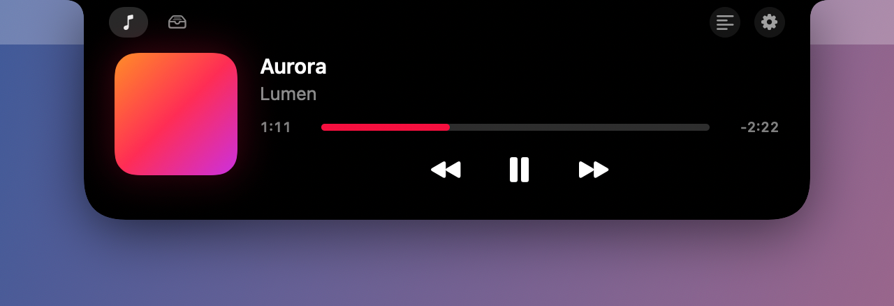
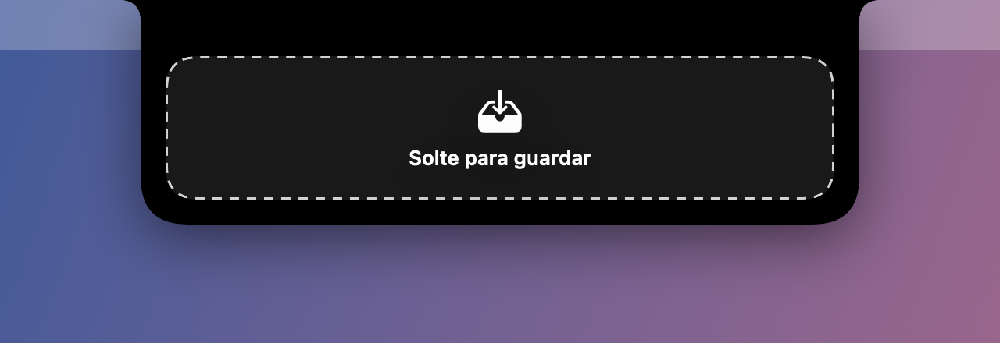
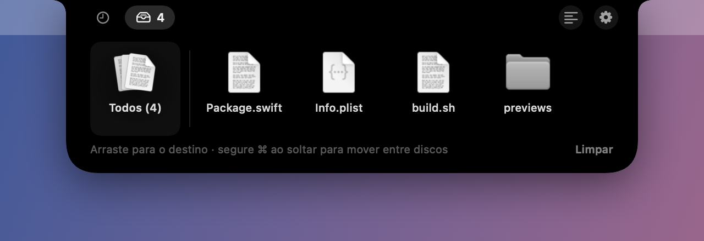
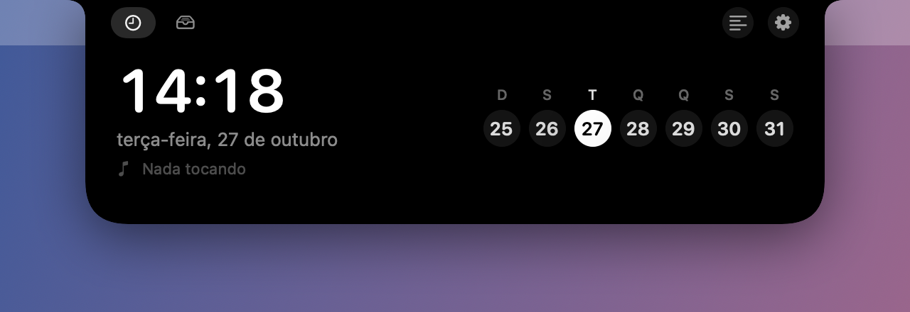

<p align="center">
  
</p>

# Marquise

**Uma Dynamic Island para o notch do Mac — com teleprompter alinhado à câmera, espelho e uma prateleira de arquivos.**

[English](README.md) · [Download](../../releases/latest) · [Novidades](CHANGELOG.md) · [Segurança](SECURITY.md)

<p align="center">
  
</p>

A Marquise mora no notch do MacBook. Fechada, ela se mistura ao notch e mostra pequenos
indicadores. Passe o mouse e ela se abre com relógio, a música que está tocando e a sua
prateleira de arquivos. Ela também vira um teleprompter logo abaixo da câmera, para você
ler um roteiro olhando quase direto para a lente, ou num espelho para você se ver antes de
uma reunião — e pode se esconder de gravações e compartilhamentos de tela.

- Swift e SwiftUI nativos, sem dependências, com menos de 1 MB
- Funciona inteiramente no seu Mac: sem conta, sem estatísticas de uso, sem rastreamento
- Português (Brasil e Portugal), inglês (EUA e Reino Unido) e espanhol

## Recursos

### Teleprompter

<p align="center">
  
</p>

- **Alinhado à webcam.** O texto corre numa coluna estreita logo abaixo da câmera, então o
  olhar fica perto da lente e a leitura não aparece.
- **Segue a sua voz** (macOS 26 ou posterior). A Marquise escuta e avança o texto conforme
  você fala, palavra por palavra. Ela lida com palavras puladas, repetidas e com quem volta
  para reler um trecho. As palavras já faladas ficam apagadas, para você não se perder.
  - O reconhecimento acontece no próprio Mac. O áudio não sai do computador.
  - Funciona em português (Brasil, Portugal), inglês (EUA, Reino Unido) e espanhol. O idioma
    é detectado pelo roteiro, ou você escolhe.
  - Na primeira vez, o macOS baixa o modelo de voz daquele idioma.
- **Velocidade fixa**, para quando você preferir não usar o microfone.
- **Escondida de capturas de tela** (ligado por padrão): a Marquise, incluindo o
  teleprompter, e a janela do roteiro ficam de fora de gravações e compartilhamentos de
  tela. Dá para desligar na janela do roteiro. Veja as [limitações](#limitações-conhecidas).
- **Ajustável:** velocidade, largura da coluna, tamanho do texto e modo espelhado para
  vidro de teleprompter.
- **Janela do roteiro** com copiar e colar, e um botão *Colar roteiro*.

| Atalho | Ação |
| --- | --- |
| <kbd>⌃</kbd><kbd>⌥</kbd><kbd>T</kbd> | Abrir ou fechar o teleprompter |
| <kbd>⌃</kbd><kbd>⌥</kbd><kbd>Espaço</kbd> | Pausar ou continuar |
| <kbd>⌃</kbd><kbd>⌥</kbd><kbd>↑</kbd> / <kbd>↓</kbd> | Mais rápido ou mais devagar |
| Rolar no trackpad | Avançar ou voltar no roteiro |
| <kbd>⌃</kbd><kbd>⌥</kbd><kbd>M</kbd> | Abrir ou fechar o [espelho](#espelho) |

Passe o mouse sobre o teleprompter para ver os controles: voz ligada ou desligada, play,
recomeçar, editar e fechar.

### Espelho

Confira o cabelo, a luz e o enquadramento antes de entrar numa chamada, mesmo em cima da
hora: aperte <kbd>⌃</kbd><kbd>⌥</kbd><kbd>M</kbd> ou clique no botão da câmera na ilha aberta.

- Mostra a câmera do Mac, espelhada, logo abaixo do notch: o mesmo que as pessoas vão ver.
- Usa a câmera embutida, mesmo com um iPhone ou uma câmera externa conectados.
- A câmera só liga enquanto o espelho está aberto. Nada é gravado nem salvo.
- Feche no botão ✕, no mesmo atalho ou clicando em qualquer outro lugar.
- Se o teleprompter estiver aberto, ele pausa por baixo e volta quando o espelho fecha.
- Fica escondido de gravações e compartilhamentos de tela, junto com o resto da Marquise.

### Prateleira de arquivos

<p align="center">
  
  
</p>

Para mover arquivos entre pastas ou discos sem copiar e colar:

1. Arraste os arquivos até o notch. Ele vira uma área de soltar e os guarda.
2. Abra a pasta ou o disco de destino.
3. Arraste-os para fora da prateleira, um por vez ou todos de uma vez.

A Marquise guarda só uma referência a cada arquivo; nada é copiado quando você o solta na
prateleira. Quando você o arrasta para fora, o Finder decide como sempre: no mesmo disco o
arquivo é movido, para outro disco é copiado. Segure <kbd>⌘</kbd> ao soltar para mover entre
discos. Os itens saem da prateleira depois de soltos em algum lugar.

### Música, volume e relógio

<p align="center">
  
  
</p>

- Capa do álbum e visualizador enquanto o **Música** ou o **Spotify** está tocando; abra a
  ilha para ver título, artista, progresso e controles.
- Mudanças de volume aparecem no notch.
- Quando nada está tocando: hora, data e a semana atual.

### Opções

Clique com o botão direito na ilha ou use a engrenagem:

- **Idioma:** automático (segue o sistema) ou qualquer um dos cinco idiomas.
- **Mostrar a ilha em:** tela principal (a da barra de menus, como um monitor externo) ou
  a tela do MacBook, com o notch.
- **Abrir ao iniciar sessão.**
- Abrir o teleprompter ou o espelho, ou sair.

## Requisitos

- macOS 14 Sonoma ou posterior, em Mac com Apple silicon ou Intel.
- Seguir a voz exige macOS 26 ou posterior.
- Feita para Macs com notch. Em outras telas, como um monitor externo, a Marquise desenha uma ilha do mesmo tamanho
  no alto da barra de menus.

## Instalação

1. Baixe o `Marquise-<versão>.dmg` em [Releases](../../releases/latest).
2. Abra e arraste a **Marquise** para **Aplicativos**.
3. Abra a Marquise em Aplicativos. Ela não tem ícone no Dock: olhe para o notch.

Também há um instalador `.pkg`, que coloca a Marquise em `/Applications`.

Para conferir o download, compare o SHA-256 com o `SHA256SUMS.txt` da mesma versão:

```bash
shasum -a 256 Marquise-1.0.dmg
```

### Permissões

O macOS pede cada uma na primeira vez em que ela é necessária. A Marquise funciona sem
nenhuma delas; só o recurso correspondente fica desligado.

| Permissão | Para quê |
| --- | --- |
| Câmera | O espelho |
| Microfone | Seguir a voz no teleprompter |
| Reconhecimento de Fala | Transformar a voz em texto, no próprio Mac |
| Automação (Música, Spotify) | Mostrar e controlar o que está tocando |

Dá para mudar depois em **Ajustes do Sistema → Privacidade e Segurança**.

## Privacidade

- **Nenhuma coleta de dados.** Sem estatísticas de uso, relatórios de erro, contas ou anúncios.
- **Internet:** a única conexão que a Marquise faz é baixar capas de álbum do Spotify, por
  HTTPS e só dos servidores de imagem do Spotify. O modelo de voz é baixado pelo macOS.
- **Câmera:** usada só enquanto o espelho está aberto, mostrada na tela e nunca gravada,
  salva ou enviada. A luz verde da câmera do Mac indica quando ela está ligada.
- **Voz:** reconhecida no Mac e usada só para achar onde você está no roteiro. Áudio e
  transcrições não são gravados nem salvos.
- **Guardado no seu Mac** (nas preferências da Marquise): o roteiro, os ajustes do
  teleprompter, o idioma escolhido e os caminhos dos arquivos da prateleira. Ficam sem
  criptografia, como a maioria das preferências de apps. Para apagar:
  `defaults delete com.marquise.app`.
- **Registros (logs)** têm só estados (por exemplo "ouvindo" ou "2 arquivos recebidos"),
  nunca o que você fala nem nomes de arquivos.

## Limitações conhecidas

- **Esconder de capturas de tela** depende de um ajuste de compartilhamento de janelas do
  macOS. Apps de reunião e gravação que capturam pelo macOS respeitam esse ajuste, mas ele
  não impede a câmera de um celular, e algumas ferramentas de captura podem se comportar de
  outro jeito. Teste com o seu app de reunião antes de contar com isso.
- Enquanto a ilha está aberta, ela cobre a área logo abaixo do notch, então cliques ali vão
  para a Marquise.
- Se outro app já usa um dos atalhos, ele não funciona na Marquise, e ainda não há aviso.
- A prateleira guarda referências, não cópias: se um arquivo for movido ou apagado por
  outro caminho, ele some da prateleira.
- Com "seguir a voz" ligado, o microfone continua ativo enquanto o teleprompter está pausado.
- O indicador de volume padrão do macOS ainda aparece junto com o da Marquise.
- O teleprompter e o espelho acompanham a ilha. Se você usa a câmera do MacBook com um
  monitor externo, escolha *Tela do MacBook* para o texto ficar logo abaixo da câmera.

## Compilar a partir do código

É preciso ter as Command Line Tools ou o Xcode com o **SDK do macOS 26** ou posterior
(Swift 6).

```bash
git clone https://github.com/rpissardini-br/marquise.git
```

```bash
cd marquise && ./build.sh && open build/Marquise.app
```

O `build.sh` assina o app com um certificado do seu Porta-chaves, para o macOS lembrar das
permissões entre compilações. Sem certificado, ele assina ad hoc e o macOS pede tudo de novo
a cada compilação. Veja no [CONTRIBUTING.md](CONTRIBUTING.md) como criar um certificado
local e como as versões são publicadas.

## Contribuir

Relatos de problemas, ideias e pull requests são bem-vindos. Leia antes o
[CONTRIBUTING.md](CONTRIBUTING.md). Para relatar uma falha de segurança, siga o
[SECURITY.md](SECURITY.md) em vez de abrir uma issue pública.

## Licença

Copyright © 2026 Rafael Pissardini

A Marquise é software livre sob a [GNU General Public License v3.0](LICENSE). Você pode usar,
estudar, modificar e compartilhar. Quem distribuir uma versão modificada precisa publicá-la
também sob a GPL-3.0, com o código-fonte.

A Marquise não é afiliada nem endossada pela Apple. Dynamic Island, Mac, macOS e Apple Music
são marcas da Apple Inc. Spotify é marca da Spotify AB.
